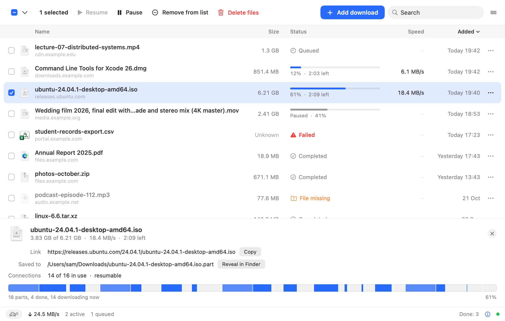
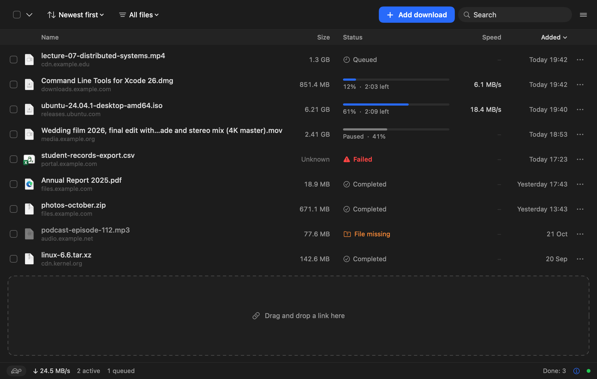
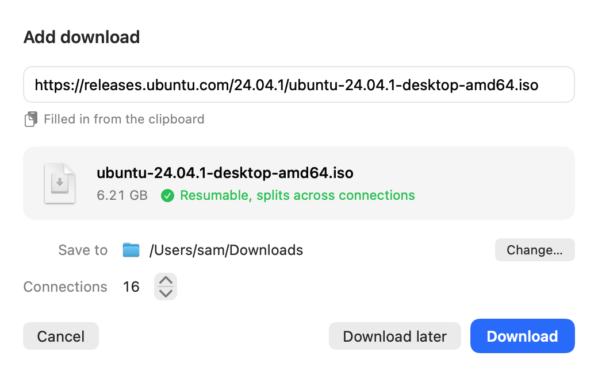
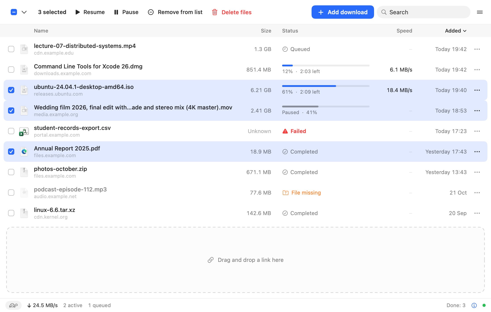

<p align="center">
  
</p>

<h1 align="center">Pluck</h1>

<p align="center">A fast, tiny download manager for the Mac. It splits each file across many connections, so big downloads finish in a fraction of the time.</p>

<p align="center">
  <a href="https://github.com/AbhishekKaisar/Pluck/releases/latest"></a>
  
  <a href="LICENSE"></a>
</p>

<p align="center">
  
</p>

## Why Pluck

- **Much faster on big files.** Pluck opens up to 32 connections to the same file at once, where a browser opens one. As each piece finishes, the largest remaining piece is split again, so every connection stays busy to the end.
- **Catches your Chrome and Edge downloads.** Click a download link as usual and the browser extension hands it to Pluck, with your cookies, so downloads from sites you are logged in to work too.
- **Pause and resume, even after a restart.** Quit the app, shut the lid or lose Wi-Fi: Pluck carries on from where it stopped.
- **See what is happening.** A live map shows every connection and how much of the file each one has fetched.
- **Light on your Mac.** A 1.2 MB download (2.4 MB installed) that runs natively on Apple silicon and Intel. It uses 0% CPU and about 19 MB of memory when idle.
- **No ads, no tracking, no account.** Free and open source under the MIT licence.

## How much faster

Same file, same Mac, same 315 Mbps line. `curl` downloads over a single connection, as a browser does.

| Download | Single connection (`curl`) | Pluck |
| --- | --- | --- |
| 100 MB file from a distant server | 493 s | 48 s with 8 connections, about 15 s with 32 |
| 140 MB file from a nearby CDN | 31 s | 4.1 s with 16 connections |

Your results depend on the server and the route to it. The gain is largest when the server is far away or limits the speed of each connection. See [why some sites are not faster](#why-are-some-downloads-not-faster).

<p align="center">
  
</p>

## Install

1. Download **Pluck-1.0.0.dmg** from the [latest release](https://github.com/AbhishekKaisar/Pluck/releases/latest).
2. Open it and drag **Pluck** into **Applications**.
3. Open Pluck. The first time, macOS says it cannot check the app for malicious software, because Pluck is not signed with a paid Apple developer certificate. To open it anyway, either:
   - right-click (or Control-click) Pluck in Applications and choose **Open**, then **Open** again; or
   - try to open it once, then go to **System Settings > Privacy & Security**, scroll down and click **Open Anyway**.

   You only need to do this once. If you would rather check the code first, everything is here and you can [build it yourself](#build-from-source).

Pluck runs on macOS 14 Sonoma or later, on both Apple silicon and Intel Macs.

### Add the browser extension (Chrome or Edge)

1. Download **Pluck-Extension-1.0.0.zip** from the same release and unzip it. Keep the folder somewhere it will stay, such as your Documents folder.
2. Open `chrome://extensions` in Chrome or `edge://extensions` in Edge, and turn on **Developer mode**.
3. Click **Load unpacked** and choose the **Pluck-Extension** folder.
4. Pin the extension, then click its icon.
5. In Pluck, open **Settings** (Cmd+,) and click **Copy** next to the token. Paste it into the extension and click **Save**. The dot turns green when the two are connected.

If you already use an earlier version of the extension, remove it, load the new folder and paste the token once more: the extension now has a fixed ID, so the browser treats it as a new extension and forgets its saved settings.

From then on, downloads of common file types (archives, disk images, installers, video, audio, documents) of 1 MB or more go to Pluck. You can change the list and the minimum size in the extension. To send any link, right-click it and choose **Download with Pluck**.

<p align="center">
  
</p>

## Using Pluck

- **Add a download** with Cmd+N. Pluck picks up a link you have copied, checks its name, size and whether it can resume, and lets you choose the folder and number of connections. Paste many links at once to add them all.
- **Choose where each download goes.** Turn on "Ask where to save each download" in Settings and the Add sheet opens for every browser download, with the default folder filled in. Click Download to accept it or Change… to pick another folder. Nothing starts until you answer, and downloads that arrive meanwhile wait their turn. If you quit first, the ones still waiting are kept in the list, paused. Cancel drops a download for good, because the browser's copy is already gone.
- **Drag** a link, or a text file of links, onto the window.
- **Select several** with the checkboxes, Cmd-click or Shift-click, then pause, resume, remove or delete them together.
- **Sort, filter and search** the list. Pluck remembers your choice.
- **Set a speed limit** in Settings and turn it on or off with the tortoise in the status bar.
- The **menu bar** shows the total speed while something is downloading.

<p align="center">
  
</p>

## FAQ

### Is it safe? What leaves my Mac?

Nothing except the downloads themselves. Pluck talks only to the servers you download from. It has no analytics, no crash reporting, no update check and no account. The browser extension talks only to Pluck on your own Mac (`127.0.0.1`), and only with the token from Pluck's Settings, so a web page cannot add downloads. Your list and settings stay in `~/Library/Application Support/Pluck`.

The extension needs permission to read downloads and cookies for all sites. It uses them only to pass a download, with the cookies the browser would have sent for it, to Pluck on your Mac. It can also ask the browser to run Pluck's small start-up script (native messaging), which only opens the app. You can read every line in [`extension/`](extension).

### Why is there no Safari extension yet?

A Safari extension has to be built and signed with Xcode and an Apple developer account. It is planned. Until then, you can paste links into Pluck (Cmd+N picks them up from the clipboard) or drag them onto the window.

### Why are some downloads not faster?

Pluck can only speed up a download when the server lets it fetch different parts of the file at the same time. Some servers do not allow that, and some links expire after the first request; Pluck then downloads over one connection, as the browser would. If your line is already the slowest part of the route, more connections cannot make it faster either. The biggest gains come from servers far away or servers that limit each connection.

### A site blocks me or fails with many connections

A few servers limit how many connections one visitor may open. Lower the number of connections for that download in the Add sheet, or set a lower default in Settings. Downloads that need a form to be submitted, or a sign-in that the browser keeps outside cookies, cannot be repeated by Pluck; turn the extension off for those sites.

### What happens if Pluck is not running when I click a download?

Pluck starts on its own, in the background, and takes the download. This works once you have opened Pluck at least once from your Mac (not from the disk image or a disk you eject), so it could set up the link that lets the browser start it. A download that does not match your filters, or one that arrives while the link is missing, is downloaded by the browser as normal. The extension only cancels the browser's copy after Pluck has accepted the download, so nothing is ever lost.

The link is a small script inside the app (`Pluck.app/Contents/Resources/pluck-host`) and a file Pluck writes into your browser's `NativeMessagingHosts` folder at each launch. If you move Pluck, open it once and the link follows it.

### Where do my downloads go?

Into the default folder in Settings (Downloads by default). To choose a folder each time, turn on "Ask where to save each download": browser downloads then open the Add sheet first. Downloads you add yourself with Cmd+N always show it, `pluck://` links show it when the setting is on, and `mdl` never asks.

### Does it work with Firefox?

Not yet. Chrome, Edge and other Chromium browsers that load Chrome extensions are supported.

## Build from source

You need the Swift command line tools (Swift 6, `xcode-select --install`). Xcode is not needed.

```sh
git clone https://github.com/AbhishekKaisar/Pluck.git
cd Pluck
./build.sh     # universal release build: build/Pluck.app and build/mdl, ad-hoc signed
./test.sh      # unit tests
open build/Pluck.app
```

`ARCHS=arm64 ./build.sh` builds for Apple silicon only, which is quicker. `scripts/release.sh` packs the built app into the DMG and zips in `build/release`.

To try a build without touching your own list and settings, point it at a scratch folder: `PLUCK_SUPPORT_DIR=/tmp/pluck-test build/Pluck.app/Contents/MacOS/Pluck`. It takes the next free port if another copy holds 6801.

### For developers

- **Engine.** A `Range: bytes=0-0` probe finds the size, range support and file name. The file is split into segments, each on its own connection, written into one preallocated `.part` file. Progress per segment is saved in `<name>.part.json`, so resume survives a crash. Failed segments retry with backoff; a watchdog replaces stalled connections. Finished files never overwrite an existing one (`name (1).ext`).
- **Speed limit.** Each connection fetches small ranges paced by a shared token bucket, so the network itself stays under the limit.
- **URL scheme.** `open "pluck://add?url=https%3A%2F%2Fexample.com%2Ffile.zip"` (optional `filename` and `referrer`). With "Ask where to save each download" on, it opens the Add sheet and waits for an answer.
- **Local API** on `127.0.0.1:6801`, or the next free port up to 6820 (the chosen port is in `server.json`):
  - `GET /ping` needs no token and returns the app name and version.
  - `POST /add` with `{"url", "filename"?, "referrer"?, "cookies"?, "userAgent"?, "fileSize"?, "ask"?}` and the header `Authorization: Bearer <token>` (or `X-Pluck-Token: <token>`). The reply is `{"ok": true, "id"}`. With `"ask": true` and the setting on, nothing is added yet: the Add sheet is queued and the reply is `{"ok": true, "asking": true}`, with no `id`.
  - `GET /list`, and `POST /control` with `{"id", "action": "pause" | "resume" | "cancel" | "remove"}`, both with the token.
  - Requests without the token get 401, requests with a web page `Origin` get 403, and only loopback connections are accepted.
- **Command line.** `build/mdl [-c connections] [-o directory] [-n filename] [-l KiB/s] URL`. Ctrl-C pauses and saves; the same command again resumes.
- **Snapshots.** `swift build --build-system native --product snapshot && "$(swift build --build-system native --show-bin-path)/snapshot"` renders the real views with sample data into `build/snapshots`, light and dark.

```
Sources/DownloaderCore/   engine, segment maths, file naming, manager, local server
Sources/PluckUI/          SwiftUI views: window, table, detail panel, Add sheet, settings, menu bar
Sources/Pluck/            app entry point, menus and keyboard commands
Sources/mdl/              command line front end to the engine
Sources/snapshot/         offscreen renderer for the views
Tests/DownloaderCoreTests/
extension/                Manifest V3 extension for Chrome and Edge
scripts/                  icon drawing and release packing
```

Pluck was called MacDownloader during development. On first launch it copies `~/Library/Application Support/MacDownloader` to `~/Library/Application Support/Pluck`, and the old `macdownloader://` links and API header still work.

## Privacy

Pluck collects nothing. There is no telemetry, no analytics and no network traffic other than the downloads you ask for. The token that connects the extension is created on your Mac on first launch and stored only there, readable by your user account alone.

## Licence

MIT. See [LICENSE](LICENSE).

## Support Pluck

<!-- donate link goes here -->
A donation link is coming soon. Until then, a star on GitHub or telling a friend helps a lot.
